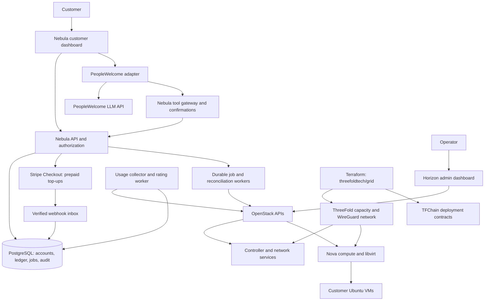

# Nebula

**An OpenStack cloud platform powered by decentralized, blockchain-coordinated compute on the ThreeFold Grid.**

Nebula brings familiar cloud workflows to distributed infrastructure: create an account, fund a prepaid balance, launch an Ubuntu virtual machine, configure its network, and manage it through a customer dashboard or the PeopleWelcome cloud assistant.

OpenStack manages customer infrastructure. ThreeFold supplies the underlying capacity, with TFChain coordinating infrastructure identities and deployment contracts. Nebula connects those layers through a customer API, usage ledger, and permission-controlled tools. Customer workloads run on compute nodes, not on a blockchain.

## Project status

**Design and repository foundation. No cloud has been deployed.**

This initial revision turns the [original project brief](docs/brief.md) into an application design, component boundaries, API contract, operating plan, and staged delivery backlog. The backend, dashboard, Terraform resources, Kolla configuration, database migrations, payment integration, and assistant adapter are planned implementation work. Their directories contain implementation guidance, not running services.

ThreeFold nested KVM, persistent disks, required network privileges, and Neutron external networking remain unverified. A successful OpenStack installation alone does not meet the MVP acceptance criteria: Nebula must launch and connect to a real customer VM, meter it, and inspect it through PeopleWelcome.

## The MVP

| Area | Intended behavior |
| --- | --- |
| Accounts | Registration, login, organizations, memberships, and project isolation |
| Compute | Create/delete Ubuntu VMs, choose instance sizes, view status and operations |
| Networking | Private tenant networks, router/NAT, security groups, and supported public ingress |
| SSH keys | Register public keys and select one at launch; never upload private keys |
| Usage | vCPU-hours, RAM GB-hours, storage GB-months, and applicable public IP-hours |
| Billing | Stripe Checkout top-ups, verified webhooks, prepaid ledger, receipts, quotas, and spending limits |
| Assistant | PeopleWelcome chat with read-only diagnostics and explicitly confirmed infrastructure changes |
| Administration | Horizon for operators; scoped customer access through Nebula |

## Architecture



The production runtime, including Nebula's API, database, workers, dashboard hosting, and OpenStack nodes, is intended to reside on ThreeFold. Stripe and PeopleWelcome are external APIs required by the brief. GitHub hosts source and CI; CI must not become the runtime. No AWS, Azure, GCP, or privately hosted runtime is part of this design.

## Planned technology

| Layer | Design choice |
| --- | --- |
| Infrastructure | ThreeFold Grid, Terraform provider `threefoldtech/grid`, WireGuard |
| Host and cloud | Ubuntu 24.04 where supported; OpenStack 2026.1, Kolla-Ansible, Docker |
| Customer dashboard | React and TypeScript, served behind a same-origin TLS reverse proxy |
| Backend | Python/FastAPI with a server-side OpenStack SDK adapter |
| Persistence | PostgreSQL, versioned migrations, transactional jobs/outbox |
| Payments | Stripe-hosted Checkout in a sandbox/test environment; Nebula prepaid ledger |
| Assistant | PeopleWelcome adapter, server-side tool gateway, scoped Keystone credentials |
| Delivery | GitHub Actions for checks; operator-approved infrastructure changes |

These application choices are design decisions, not installed dependencies. Implementation must pin supported tool and SDK versions and verify provider schemas before deployment.

## Repository

```text
nebula/
  README.md                    Project overview and current status
  LICENSE                      Existing MIT license
  .env.example                 Empty configuration contract; no credentials
  docs/
    brief.md                   Original supplied requirements
    architecture.md            Services, trust boundaries, data model, and jobs
    product.md                 Dashboard, workflows, API, and roles
    billing.md                 Prepaid ledger, metering, and reconciliation
    assistant-security.md      PeopleWelcome tools and security controls
    infrastructure.md          ThreeFold topology and compatibility gates
    operations.md              Deployment sequence, evidence, and runbooks
    roadmap.md                 Milestones and requirements traceability
    sources.md                 Primary references and verification limits
  services/api/                Backend implementation boundary
  apps/dashboard/              Customer dashboard implementation boundary
  db/migrations/               Database migration boundary
  infra/terraform/             ThreeFold provisioning boundary
  infra/kolla/                 Ansible/Kolla deployment boundary
  extensions/                  Future provider interfaces
```

## Get started

Clone the repository and read the implementation sequence:

```powershell
git clone https://github.com/Heraldic-Clouds/Nebula.git nebula
cd nebula
Get-Content README.md
Get-Content docs/roadmap.md
Copy-Item .env.example .env
```

Copy `.env.example` only when preparing a local development environment. Keep `.env` private and supply real configuration through local environment variables or an operator-controlled secret store. The template is not a configured application.

Start with the [infrastructure compatibility gate](docs/infrastructure.md), then implement the [backend and customer flows](docs/product.md). The [operating plan](docs/operations.md) distinguishes future deployment commands from what exists today. There is no application start command or deployable Docker Compose stack in this design revision.

## Deployment gates

1. Select candidate ThreeFold nodes and obtain an actual quote. Approve the exact billable test deployment before applying Terraform.
2. Provision a test VM and verify root/SSH access, CPU flags, `/dev/kvm`, an actual nested guest, storage persistence, network interfaces, and necessary privileges.
3. Verify VM-to-VM connectivity, tenant overlay MTU, router/NAT, public ingress, and the external routing/allocation model needed by Neutron.
4. If KVM is unavailable, permit an explicitly opted-in QEMU/TCG development experiment only. Its performance is severely limited; it is not a production compute tier.
5. Stop the affected stage if virtualization or networking is unsupported. Record the blocker rather than replacing the required runtime with another cloud.
6. Deploy OpenStack and complete the twelve-step [acceptance run](docs/operations.md#end-to-end-acceptance-run).

Never purchase resources or run a billable `terraform apply` without explicit approval. Keep payments in test mode until metering and reconciliation are validated. Never grant balance from a browser success redirect.

## Cost and compatibility

**No nodes have been selected, no capacity has been purchased, and no infrastructure cost has been quoted.** The cost worksheet and required compatibility evidence are in [infrastructure.md](docs/infrastructure.md). Example sizing is a planning target, not an available-node claim or price estimate.

Kolla-Ansible's [2026.1 support matrix](https://docs.openstack.org/kolla-ansible/2026.1/user/support-matrix) lists Ubuntu 24.04. This supports the host OS choice; it does not prove ThreeFold can host nested OpenStack. See [sources and open questions](docs/sources.md).

## Future compatibility

Keep adapters available for Akash GPU capacity, Golem compute, Storj object storage, Kubernetes provisioning, GPU instances, Marco Polo coin payments, and hosting PeopleWelcome, Stratus-2, Amzy, and STAS. These are future integrations and are not implemented in the MVP. Additional ThreeFold nodes use the same provisioning boundary.

## Contributing and license

Read [CONTRIBUTING.md](CONTRIBUTING.md) before implementing a component. Record evidence for deployment claims, preserve tenant isolation, and keep credentials out of Git, logs, browser bundles, and AI prompts.

Maintainer identity for this repository: **TantalusDenton** (`thomasdxdenton@hotmail.com`). Licensed under the existing [MIT license](LICENSE).
