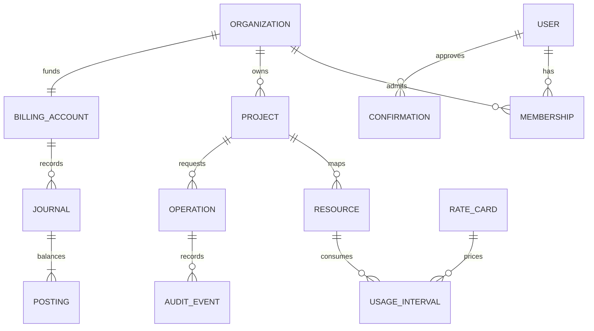

# Application architecture

Status: proposed implementation design, derived from [the supplied brief](brief.md).

## Responsibilities and trust boundaries

| Component | Owns | Must not own |
| --- | --- | --- |
| Dashboard | User interaction, estimates, confirmations, operation status | Keystone/Stripe secrets or authorization decisions |
| API | Sessions, membership, quotas, admission checks, operation creation | Hypervisor scheduling or browser-supplied tenant identity |
| Operation worker | Execute/reconcile durable requests through OpenStack APIs | Unbounded retries or cross-project access |
| OpenStack adapter | Scoped SDK clients, provider IDs, error normalization | Customer billing policy |
| Billing workers | Usage collection, rating, ledger settlement, reconciliation | Payment success inferred from the dashboard |
| Webhook receiver | Signature verification and durable event inbox | Arbitrary event-driven balance edits without validation |
| PeopleWelcome adapter | Verified provider protocol and conversation exchange | Direct administrator access or arbitrary shell execution |
| Tool gateway | Tool allowlist, authorization, estimates, confirmations, audit | Trust in model-provided roles, organization IDs, or approvals |
| Terraform/Kolla | Operator-managed deployment and configuration | Customer-requested wallet operations |

Use a modular monolith for the first backend: FastAPI routes and domain services share PostgreSQL, while separately runnable workers consume database-backed jobs. This avoids adding an unrelated distributed queue to the initial MVP. OpenStack's RabbitMQ remains an OpenStack service, not a customer-accessible task broker.

Serve the dashboard and API under one HTTPS origin. Use secure, HttpOnly, SameSite session cookies, server-side session revocation, and CSRF protection on state-changing requests. Registration needs email verification; password storage needs a modern password hash such as Argon2id. Select and verify the delivery path for transactional email before public registration opens.

## Tenant model

An organization is the customer account and prepaid wallet owner. It has members with roles and one or more Nebula projects. Each Nebula project maps to a Keystone project in the configured domain/region. Resource authorization starts from a database project lookup and current membership; never accept a raw OpenStack project ID from the browser or the model as authorization.

A restricted onboarding service creates Keystone projects, roles, and application credentials. Ordinary API and worker requests use project-scoped credentials. Encrypt stored credentials using an operator-managed key outside the database and repository. Horizon operator credentials remain separate from Nebula customer sessions.

The OpenStack adapter must verify a resource's project ownership before returning details or changing it. Cache entries include project and region. Staff access uses a separate authenticated operator role and produces an audit record.

## Data model

| Entity | Important fields and constraints |
| --- | --- |
| `users`, `sessions` | Unique normalized email, password hash, verified timestamp, expiring hashed session tokens |
| `organizations`, `memberships` | Unique `(organization_id, user_id)`, explicit role, membership state |
| `projects` | Organization FK, unique `(region, keystone_project_id)`, credential reference, lifecycle state |
| `resources` | Project FK, provider/type/ID, current observed state, desired state, last observation, deletion tombstone |
| `operations` | Actor/project, action, canonical request hash, unique project/action/idempotency key, status, provider correlation ID |
| `jobs`, `outbox` | Operation/event FK, available timestamp, retry count, lease expiry, deduplication key |
| `billing_accounts`, `reservations` | Organization, currency, locked balance projection, reserved amount, linked operation and expiry |
| `rate_cards`, `rates` | Immutable version, currency, effective range, resource/unit, fixed-point rate |
| `usage_observations`, `usage_intervals` | Project/resource, source, timestamps, quantity/state, coverage, unique settlement identity |
| `journals`, `postings` | Immutable balanced accounting entries with source ID, reversal reference, currency, integer micro-units |
| `payment_events`, `topups` | Unique Stripe event ID and Checkout session ID, expected amount/currency/customer, processing state |
| `statements` | Period, immutable line items, ledger references, generated artifact reference |
| `confirmations` | Actor/session/project, exact action and parameter hash, quote version, expiry, consumed timestamp |
| `audit_events` | Actor, origin (UI/assistant/operator), project, operation, request hash, outcome, redacted detail |

Schema migrations must enforce foreign keys, tenant association, uniqueness, monetary invariants, and useful time/project indexes. Application checks supplement database constraints. Integration tests should use PostgreSQL to exercise row locking and concurrency.

## Provisioning lifecycle

1. Resolve the session and project membership; validate an allowed image, size, network, key, and public IP request.
2. Read live admission configuration. Reject stale metering, unavailable capacity, disabled rates, exhausted quota, insufficient funds, or spending limits before contacting OpenStack.
3. In one transaction, claim the idempotency key, lock the billing account, reserve the required credit/quota, and persist the operation and outbox job.
4. Return `202 Accepted` with an operation URL. A worker leases the job and calls Nova using scoped credentials and a Nebula operation tag/metadata correlation value.
5. Persist the provider ID and reconcile until the resource reaches the expected state. If the API call times out, search/reconcile before retrying creation; exactly-once remote execution cannot be assumed.
6. On failure, record a terminal error and release unused reservations after reconciling actual resources. Clean up owned intermediate ports or IPs deliberately.
7. Convert reservations to the appropriate usage coverage and keep state synchronized through scheduled reconciliation. Preserve independent resources such as retained volumes and IPs until explicitly released.

Deletion uses the same operation flow. A delete request does not stop billing by itself. Metering ends according to observed resource deletion/release, with a final settlement interval and an auditable tombstone. Repeating a completed delete returns the existing outcome.

## Failure handling

Workers need bounded exponential backoff, database leases, crash recovery, and a dead-letter state visible to operators. Reconciliation must detect resources created after ambiguous timeouts, missing/deleted resources, manual Horizon changes, leaked ports/IPs, and expired holds. PostgreSQL commit and OpenStack actions are not one atomic transaction; explicit reconciliation is required.

Keep immutable audit and billing facts separate from mutable resource status. Use UTC timestamps throughout. A resource observation must include its collection time and freshness rather than silently showing cached state as live.

## Deployment boundaries

The initial OpenStack deployment has one controller/network node and one compute node. Host Nebula application containers and PostgreSQL on ThreeFold capacity, sharing the controller only for an isolated development pilot if capacity and isolation allow it. Use a separate application node before public service. See [infrastructure](infrastructure.md) for sizing hypotheses and why three controllers alone do not establish HA.

GitHub Actions validates code and configuration. Deployment jobs must be separated from pull-request checks, use protected environments, and wait for explicit approval of any billable infrastructure operation. Production credentials never enter pull-request execution.
