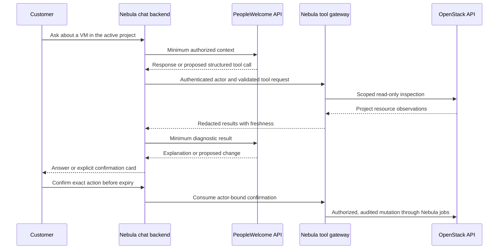

# PeopleWelcome assistant and security design

Status: adapter and gateway design. No PeopleWelcome endpoint, protocol, credentials, or live integration has been verified.

## Request path

PeopleWelcome handles language and AI identity. Nebula owns authentication, tools, policy, execution, and audit. If PeopleWelcome is unavailable, return a clear error; do not silently substitute another AI provider or invent diagnostic output.

## Tool contract

| Tool | Permission and behavior |
| --- | --- |
| `list_instances`, `get_instance` | Read-only project-scoped resource data |
| `get_network_diagnostics` | Read-only ports, subnets, routes, security-group rules, and observations |
| `get_usage`, `get_balance_summary` | Read-only data filtered by the caller's infrastructure/billing permission |
| `propose_instance_create` | Validate catalog, quote and quota; return a confirmation, no provisioning |
| `propose_instance_delete` | Resolve exact VM and retained resources; explain data loss |
| `propose_network_change` | Validate intended network/router action and show impact |
| `propose_security_group_change` | Show exact rule additions/removals and exposure impact |
| `explain_docker_deployment` | Return instructions the customer can review; no guest shell execution |

Mutation tools return a proposal until an authenticated customer confirms it. An explicit request in chat initiates a proposal, not an invisible resource purchase. Read-only diagnostics still require authorization and are rate limited.

Each tool uses a strict schema and allowlisted values; project context comes from the authenticated session. The model cannot supply an effective role, switch to another customer's project, select arbitrary URLs, execute shell, upload arbitrary code, or request Keystone administrator tokens.

## Confirmation lifecycle

1. Canonicalize the exact action and parameters; bind the proposal to actor, session, organization, project, resource IDs, rate/quote version, cost, and security impact.
2. Store an opaque confirmation reference with a short expiry and single-use state. The frontend displays the actual structured proposal; model prose is not the authorization record.
3. On confirmation, recheck membership, target ownership, quote, available funds, quotas, capabilities, and resource state. Changed parameters or expired estimates require a fresh proposal.
4. Atomically consume the confirmation and create an idempotent operation. Retry of the same confirmed request returns that operation.
5. Audit the proposal, approval, job execution, result, and failure. Never let a model assertion such as "the user approved" satisfy this flow.

Browser confirmation and assistant confirmation must use the same domain admission services. Destructive, billable, or security-sensitive changes always require explicit confirmation.

## Credentials and isolation

- Use scoped Keystone application credentials for project actions. Keep operator onboarding/admin credentials separate and unavailable to chat tools.
- Keep wallets, Stripe keys, session secrets, database credentials, and WireGuard/Kolla secrets server-side; never include them in model context.
- Encrypt provider credentials at rest and design key rotation/revocation. Revoke project credentials when access is removed.
- Use TLS verification for OpenStack, Stripe, PeopleWelcome, and the public console. Restrict service egress to configured endpoints; do not accept model-supplied destinations.
- Keep MariaDB, RabbitMQ, PostgreSQL, libvirt, and internal OpenStack services off the public Internet. Restrict Horizon to operator VPN access with appropriate authentication.
- Rate limit authentication, chat, top-up creation, and infrastructure mutations. Keep a strict body size, timeout, and tool execution budget.

## Untrusted content and audit

Instance names, metadata, API errors, logs, images, and model/tool responses are untrusted data. They cannot modify instructions, authorize changes, choose a tenant, or access secrets. Sanitize rendered content and links; block arbitrary HTML. Diagnostics should avoid guest logs containing private customer data unless explicitly supported and authorized.

Audit records identify the human actor, tool, project, request/confirmation/operation IDs, parameters or redacted parameter hash, timestamps, provider IDs, and outcome. Store the minimum conversation context needed, choose retention/deletion rules before public launch, and disclose PeopleWelcome as a data recipient. Do not keep secrets in transcripts or logs.

The identity provider, email verification/password reset delivery, operator MFA, secret-store implementation, retention policy, and verified PeopleWelcome API contract must be settled during implementation. Local role checks and mock assistant fixtures cannot establish production tenant isolation or a working PeopleWelcome connection.

## Required verification

Test cross-tenant resource IDs, removed membership, confirmation reuse/expiry/tampering, rate changes after proposal, concurrent balance checks, model-forged approvals, prompt injection in diagnostic content, dangerous tool names, arbitrary destination URLs, provider timeouts, missing credentials, and redaction. Live acceptance requires an actual PeopleWelcome request that inspects the test VM through an authorized tool.
